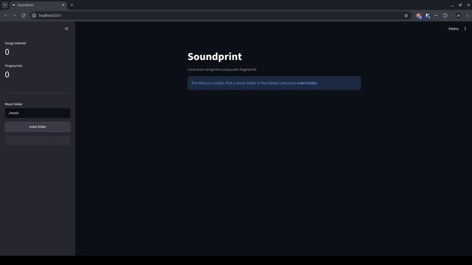
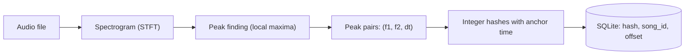

# Soundprint
 
Audio fingerprinting engine in Python. It identifies a song from a short, noisy clip (microphone or file) using the audio fingerprinting approach. The project ships with a Streamlit web app and a CLI tool.

**Built with:** Python, NumPy, SciPy, librosa, SQLite, Streamlit.



**Live demo:** [Streamlit App](https://soundprint-vhkn85f8qwhzzxscxsxh73.streamlit.app/). To try it, play a track from the [demo playlist](https://open.spotify.com/playlist/7dKXIIhMrMwOjUMiXPzypP?si=29bae54ba3534a4e) and record it in the app.
 
## Features
 
- Recognizes a track from a 5 to 10 second clip and reports where in the track the clip comes from.
- No machine learning and no training data: a deterministic algorithm with exact hash lookups.
- Parallel indexing with `multiprocessing`.
- Confidence scoring.
- Web app (record in the browser or upload a file) and a CLI intefrace.

## Quick start
 
**Requirements:** Python 3.10 or newer. On Linux, install PortAudio first (needed by `sounddevice`): `sudo apt install libportaudio2`.
 
```bash
git clone https://github.com/dima-kharchenko/soundprint.git
cd soundprint
python -m venv .venv
source .venv/bin/activate   # Windows: .venv\Scripts\activate
pip install -r requirements.txt
```
 
Put audio files (mp3, wav, flac, ogg) into `./music`. The repository does not include any music. Then build the index and start the app:
 
```bash
python populate_db.py ./music
streamlit run app.py
```
 
Already indexed files are skipped, so the command can be re-run after adding tracks. The database is stored in `fingerprints.db` in the working directory.
 
## Usage
 
### Web app
 
`streamlit run app.py`
 
- **Record** a clip in the browser or **upload** an audio file.
- The result shows the track, the number of aligned hashes, the position in the track, the search time, and how much stronger the winner is than the runner-up. A table lists the top five candidates.
- The sidebar shows library statistics, indexes a folder, and lets you change the analysis length and the minimum score.

### Command line
 
```bash
python main.py                              # record 10 s from the default microphone
python main.py --devices                    # list audio devices
python main.py --device 3 --seconds 8       # record from a specific device
python main.py --file clip.mp3 --start 45   # recognize a clip taken from a file
python populate_db.py ./music --workers 4   # index a folder with 4 processes
```
 
Example output (names and numbers are illustrative):
 
```
 score     at  track
   665   0:20  track_a.mp3
    76   0:37  track_b.mp3
    59   0:20  track_c.mp3
 
Time: 0.62 s
```

## How it works
 
### 1. Indexing: audio to fingerprints
 

 
1. **Spectrogram:** Audio is converted to mono at 22.05 kHz and transformed with a short-time Fourier transform (window 2048 samples; hop 512 samples). The result is a time-frequency map of loudness in dB.
2. **Peaks:** A point is kept only if it is the maximum of its 30x30 neighborhood and lies within 30 dB of the loudest point in the clip. These "constellation" points are the loudest, most isolated parts of the sound, so they tend to survive noise, compression and room acoustics.
3. **Pairing:** Peaks are sorted by time, and each peak (the anchor) is paired with the next 10 peaks. Each pair is described by `(f1, f2, dt)`: the two frequencies and the time gap between them.
4. **Hashing:** The triple is packed into a single integer. Together with the anchor's time in the song, it is stored in SQLite as `(hash, song_id, offset)`. A pair of peaks plus the gap between them form a fingerprint, and it does not depend on where in the song the clip starts, which is what makes matching possible.
 
### 2. Recognition: voting on time offsets
 

 
For every hash in the clip, the database returns all places where that hash occurs. Each occurrence casts a vote for `(song, offset)`, where
 
```
offset = time of the hash in the song - time of the hash in the clip
```

So the score of a song is the height of the tallest bar in its offset histogram, and a true match shows up as one sharp spike. The offset of that spike is reported as the position in the track.
 
A result is accepted as a match when the best song has at least 15 aligned hashes and at least twice the score of the runner-up. Anything else is reported as "no confident match". Both thresholds are heuristics and can be tuned.
 
### Parameters
 
| Parameter | Value |
|---|---|
| Sample rate | 22,050 Hz, mono |
| STFT window / hop | 2048 / 512 samples |
| Frequency resolution | about 10.8 Hz per bin |
| Peak neighborhood | 30x30 window |
| Peak threshold | within 30 dB of the loudest point of the clip |
| Pairing | each anchor with the next 10 peaks |
| Time resolution (hash gap, offset bins) | 0.1 s |
| Default analysis window | first 10s of a clip |
 
## Project structure
 
```
.
|-- app.py            Streamlit web app
|-- main.py           CLI: recognize from the microphone or a file
|-- populate_db.py    CLI: fingerprint a folder into the database
|-- functions.py      Spectrogram, peaks, hashes, matching, recording
|-- db.py             SQLite schema and parallel indexing
`-- requirements.txt  Python dependencies
```

## Limitations

- Only the same recording is recognized reliably. Covers, live versions, and pitch or tempo changes reduce accuracy.
- Matching currently performs one SQL query per hash, which may become a bottleneck for large libraries.
- The relative peak threshold can cause loud transients to suppress quieter, useful peaks.
- Confidence thresholds are heuristic and have not yet been extensively evaluated.

## Roadmap

- [ ] Add batch database lookups to improve matching performance.
- [ ] Build an evaluation script to measure recognition accuracy under noise.
- [ ] Add unit tests for fingerprint generation and matching.
- [ ] Add Docker support for easier setup and deployment.

## References
 
- A. Wang, *An Industrial-Strength Audio Search Algorithm*, ISMIR 2003.
- https://willdrevo.com/fingerprinting-and-audio-recognition-with-python/
- https://github.com/BernardoOlisan/shazam-algorithm

## License
 
MIT. Audio files are not part of this repository and are not covered by the license; index only music you have the right to use.
 
